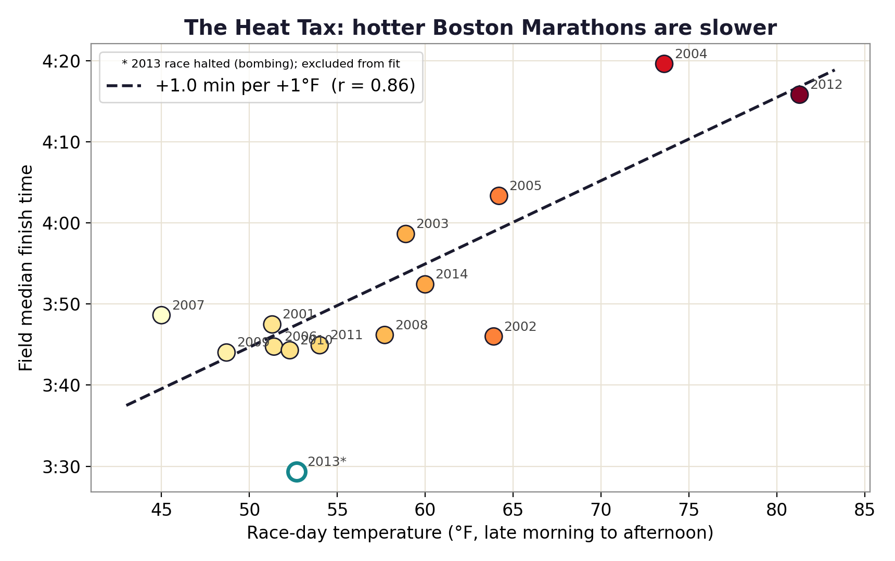

# The Heat Tax

How much does race-day heat slow a marathon field? I lined up fourteen Boston Marathons (2001 to 2014) against the temperature on the course each day, and the answer came out close to a minute per degree.

[Live site](https://lyhjeremy.github.io/marathon-heat-tax/) · [Write-up](https://lyhjeremy.github.io/marathon-heat-tax/overview/)

Design and copy follow [these standards](https://github.com/lyhjeremy/lyhjeremy/blob/main/DESIGN_STANDARDS.md).

## Results

- The field's median finish time rises **1.03 minutes per °F** (OLS slope, standard error 0.19).
- Correlation between race-day temperature and the median finish is **r = 0.86** (p = 0.0002, 13 races; 0.82 with 2013 included).
- A 50°F race versus an 80°F race: about **31 minutes** on the median finish.
- The two races above 70°F were the two slowest fields: 2004 (73.6°F, median 4:20) and 2012 (81.3°F, median 4:16).



## Method

For each year, `analyze.py` takes the median of the official finish times of everyone who finished between 2 and 8 hours (13,422 to 31,939 finishers per year, 280,459 in total). Race-day temperature is the mean of hourly 2 m readings from 10:00 to 16:00 local time near the course midpoint (42.30 N, 71.35 W), from the Open-Meteo historical archive.

The relationship is a Pearson correlation and an ordinary least squares fit (`scipy.stats.linregress`) of median finish on temperature. 2013 is excluded from the fit because the race was halted after the bombing, which truncates its finisher field. It is still plotted, drawn hollow.

Stack: Python, pandas, SciPy, matplotlib. The landing page and write-up are static HTML on GitHub Pages.

## How to run

```bash
pip install -r requirements.txt
python fetch_data.py     # downloads 2001-2014 results and Open-Meteo race-day weather into data/
python analyze.py        # writes figures/ and tables/heat_tax.csv
```

## Repo layout

| Path | Contents |
|---|---|
| `fetch_data.py` | Downloads results and weather (cached in `data/`, git-ignored) |
| `analyze.py` | Per-year medians, correlation and fit, figures |
| `tables/heat_tax.csv` | Per-year temperature, median, mean, quartiles and finisher count |
| `figures/` | Scatter and year-by-year charts |
| `index.html`, `overview/` | Landing page and full write-up |
| `writeup.md` | Short write-up |

## Data

Official Boston Marathon results 2001 to 2014 via [llimllib/bostonmarathon](https://github.com/llimllib/bostonmarathon); race-day temperatures from the free [Open-Meteo](https://open-meteo.com/) archive.

## Limitations

Thirteen points describe a relationship; they can't show cause. Field size more than doubled over the period and qualifying standards changed, and either could move the median. Humidity, sun and wind were not modeled, so read the slope as the cost of a warm race day, with whatever else a warm day brings. It describes the field median and says nothing about how any one runner handles heat.

## License

[MIT](LICENSE) © 2026 Jeremy Lee
