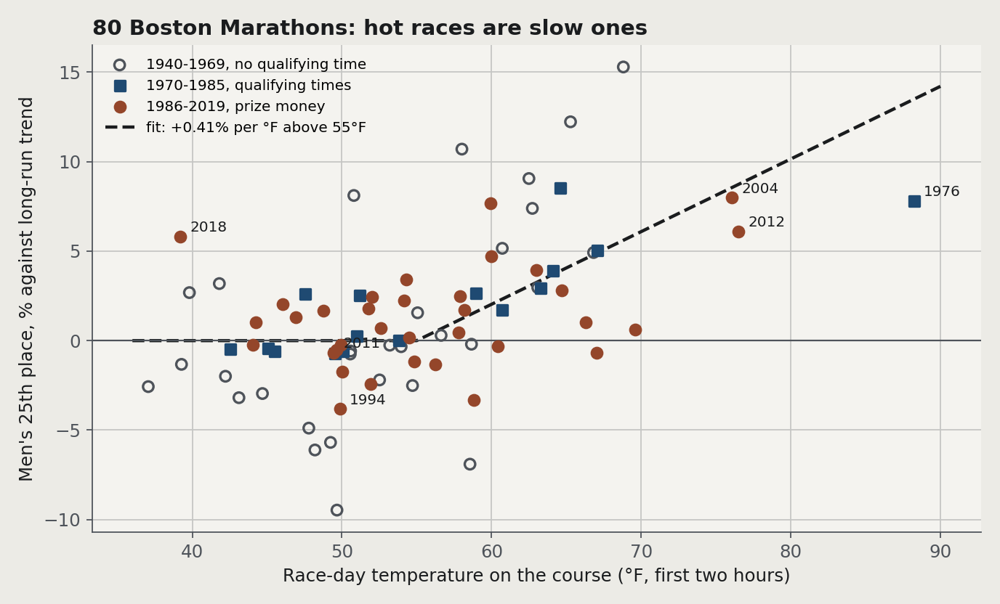

# The Heat Tax

How much does race-day heat slow a marathon field? I lined up every Boston Marathon from 1940 to 2019 against the weather on the course that day. Below about 55°F the temperature makes no measurable difference. Above it, the median finisher loses 0.42% of their time per °F, close to a minute at a 3:47 finish, and the share is similar from the front of the race to the back.

[Live site](https://lyhjeremy.github.io/marathon-heat-tax/) · [Write-up and forecast tool](https://lyhjeremy.github.io/marathon-heat-tax/overview/)

Design and copy follow [these standards](https://github.com/lyhjeremy/lyhjeremy/blob/main/DESIGN_STANDARDS.md).

## Results (October 2026)

- Heat cost above 55°F, as a share of finish time per °F: 0.42% for the median runner (90% bootstrap interval 0.20 to 0.52, 16 races), 0.41% for the 25th man (0.28 to 0.62, 75 races). All nine positions in the field fall between 0.29% and 0.46%.
- In minutes that is 0.43 per °F for the 10th man (2:13), 0.95 at the median (3:47) and 1.34 at the 90th percentile (5:01).
- The 55°F bend was picked by leave-one-year-out cross-validation from 40°F to 60°F. It removed 37% of the trend-only model's error; a straight line in temperature removed 32%.
- Dew point did not help. On its own it removed none of the error, the NWS heat index did about as well as plain temperature (35%), and adding dew point, humidity, wind, rain, sun or cloud to temperature made the cross-validated predictions worse.
- Wind along the course: each mph of tailwind took 0.08% (10th man) and 0.11% (25th man) off the time. For the field percentiles the estimate had the wrong sign and a wide interval, so `heat_model.py` applies the front-of-race rate (0.095% per mph of headwind) to everyone.
- The heat slope barely moves with the trend choice for the field percentiles (median 0.42 to 0.45 under five choices). At the front it halves if the trend is ignored (0.24 against 0.41 for the 25th man).
- Holdout, 2015 to 2019, never used for fitting or choices: the weather part of the model had an average error of 2.26% of finish time across nine series and five races, against 2.15% for a flat guess with no weather. It was right on 2015 (0.90% against 2.76%) and 2016, and badly wrong on 2018 (cold rain and a 15 mph headwind, which the model scores as ideal). 33 of 45 actual values fell inside the 80% bands.



### Superseded June 2026 result

The first version (June 2026) used 14 races (2001 to 2014) and reported 1.03 minutes per °F on the median (standard error 0.19, r = 0.86) and 31 minutes from 50°F to 80°F. Its `official` times from llimllib were gun times in 2001 to 2005 and 2012, which made hot 2004 and 2012 look 10.2 and 4.8 minutes slower than their chip times. On the same 13 races with chip times and the new weather window the straight-line slope is 0.76. The new model gives 0.95 minutes per °F above 55°F and nothing below, about 25 minutes from 50°F to 80°F. Applied to the 2015 to 2019 medians, the old line was off by 8.8 minutes on average and the new model by 6.3. `legacy_2001_2014.py` rebuilds the old numbers, `tables/heat_tax.csv` and `figures/01_*.png`, `02_*.png`.

## Method

Results are from [adrian3/Boston-Marathon-Data-Project](https://github.com/adrian3/Boston-Marathon-Data-Project) (pinned to commit `cc4fdd8`), one file per year. Lists before 1975 hold only the leading 25 to 285 finishers and lists from 1975 to 1995 stop at a time limit, so the study uses three kinds of series, each where the list supports it: the 10th and 25th man (1940 to 2019), the 100th and 1000th man (1975 to 2019), and the 10th to 90th percentile of all finishers in years whose list runs past five hours (1998 to 2019; 1996, the centennial, and 2013, the halted race, are left out). For 2001 to 2014 the counts match [llimllib/bostonmarathon](https://github.com/llimllib/bostonmarathon) within 0.6% outside 2013 (`tables/source_reconcile.csv`). Wheelchair and handcycle entrants are excluded.

Weather is hourly ERA5 from the [Open-Meteo](https://open-meteo.com/) historical archive at Hopkinton, Wellesley and the Boylston Street finish. `tables/race_days.csv` gives each race's date and start (April 19 through 1968, the third Monday of April from 1969; noon through 2006, 10:00 from 2007, waves to 11:15 by 2015) with sources. The front series use the two hours after the start; the others the start to about four hours after the last wave. Wind is averaged as a vector and projected on the course bearing (69.6°).

Each series is fitted by OLS as log(time) = restricted cubic spline in year + slope × max(temperature − 55°F, 0). The heat variable and bend were chosen by leave-one-year-out cross-validation on 1940 to 2014 only. Intervals come from 1,000 bootstrap resamples of race years. 2015 to 2019 are the holdout; the shipped model is the one fitted without them.

## Using the model

```python
from heat_model import heat_effect
heat_effect(226.8, 75)                    # finish in minutes on a cool day, race-hour temperature in °F
# {'expected_slowdown_min': 19.8, 'lo_min': ..., 'hi_min': ..., 'percentile_used': 50.0,
#  'baseline_temp_f': 55.0, 'model_version': 'heat-2026.10.1'}
heat_effect(240, 75, headwind_mph=10)     # headwind along the course in mph; negative for a tailwind
```

`heat_model.py` needs only NumPy and reads `model/heat_model.json`. The interval is a 90% bootstrap interval over race years (parameter uncertainty only). `dewpoint_f` is accepted but unused. `model/MODEL_READY` holds the commit that produced the model.

The write-up page has a forecast tool that runs the same arithmetic in the browser. It calls Open-Meteo directly (forecast API up to 16 days ahead, archive for past dates and for climatology, geocoding for a town search) and makes no other request.

## How to run

```bash
pip install -r requirements.txt
python fetch_data.py      # results and weather into ~/data-cache/marathon-heat-tax/, writes tables/race_days.csv
python build_dataset.py   # tables/field_by_year.csv, weather_by_year.csv, source_reconcile.csv
python model_fit.py       # selection, fits, bootstrap, holdout; tables/*.csv and model/heat_model.json
python figures.py         # figures/03 to 06
python export_web.py      # assets/heat_data.js for the pages
```

`model_fit.py` takes a few minutes, mostly the cross-validation. The page fragment lives in the portfolio tooling (`overview-pages/fragments/heat-tax.html`) and is built into `overview/index.html`.

## Repo layout

| Path | Contents |
|---|---|
| `fetch_data.py`, `build_dataset.py` | Downloads (to a cache outside the repo) and the per-year tables |
| `model_fit.py`, `heat_model.py`, `model/` | Fitting and the exported model |
| `figures.py`, `export_web.py` | Static figures and the data file for the pages |
| `legacy_2001_2014.py` | The June 2026 analysis |
| `tables/` | Race days, per-year field and weather, series, slopes, robustness, model selection, holdout |
| `index.html`, `overview/`, `assets/` | Landing page, write-up with forecast tool, chart script and data |

## Limitations

The field percentiles rest on 16 training races, only two above 70°F, so their intervals are wide. The 55°F bend was chosen once across all series and the bootstrap does not redo that choice, so the intervals are somewhat too narrow. The model has no term for cold rain and missed 2018 badly. ERA5 is a 0.25-degree grid, not a thermometer on the road. A spline in the year absorbs slow changes in the field (qualifying times from 1970, prize money from 1986, growth, charity places) but not a sudden one, such as the deferrals offered before the 2012 heat. Times before 2001 are as adrian3 publishes them and are probably gun times. Everything describes Boston fields in April.

## License

[MIT](LICENSE) © 2026 Jeremy Lee
